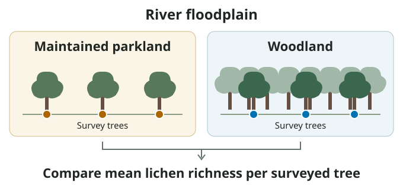
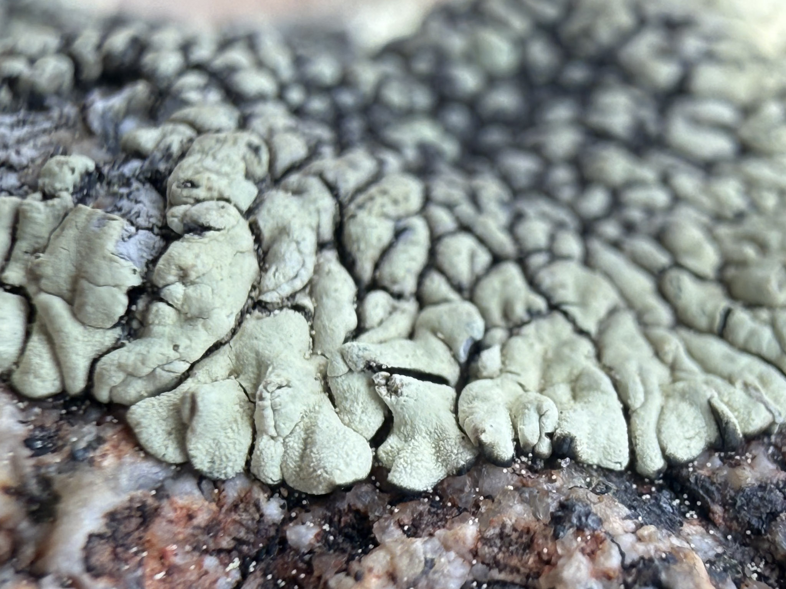
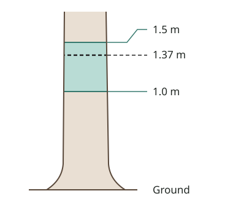

## Overview

Trees in mowed parkland and woodland both provide bark for lichens to grow on, but the conditions around those trees can differ. Do the two habitats support the same number of lichen types per tree?

{fig-alt="Sample several trees in maintained parkland and woodland within the river floodplain, then compare mean lichen richness per surveyed tree between the two habitats." width="680"}

In this lab, you will count the distinct lichen types on a standard section of each tree trunk and compare average counts between maintained parkland and relatively unmanaged woodland in the river floodplain.

## Learning objectives

By the end of this lab, you will be able to:

- Recognize distinct lichen types using visible traits.
- Measure lichen richness using a standardized field survey and record observations in ArcGIS Field Maps.
- Interpret differences in lichen richness between habitats.

## Before lab

- Read the background and field methods below.
- Install ArcGIS Field Maps on your phone and make sure you can sign in with your university ArcGIS account.
- Preview the [lichen survey worksheet (PDF)](lichen-survey-worksheet.pdf). You’ll receive a printed copy in lab.

## Background

A lichen is an association between a fungus and a photosynthetic partner, usually a green alga or a cyanobacterium. On tree bark, lichens may form thin crusts, flat leafy lobes, or branching tufts. For this survey, use visible traits such as growth form, color, lobe shape, and texture to distinguish lichen types. We’ll call each visually distinct type a **morphospecies**.

{fig-alt="Close-up of a pale gray-green lichen with tightly packed, rounded lobes on speckled rock." fig-align="center" width="70%"}

Trunks in mowed parkland may receive more light but dry faster than shaded trunks in woodland. Lichens need light to photosynthesize, and they can photosynthesize only while hydrated. Some types may do better where they receive more light, while others may do better where they stay moist longer. When local conditions favor some types and limit others, we call that **environmental filtering**. As you make your prediction, consider which habitat might provide suitable conditions for more lichen types and why.

In this lab, **richness** is the number of distinct lichen types you find in the surveyed band of a trunk. **Composition** is which types are present. Two trees can have the same richness even if you find different lichen types on each.

## Before sampling

On your worksheet, predict how mean lichen richness will compare between maintained parkland and woodland. Give an ecological reason for your prediction.

## Field methods

Work in groups of two or three. Before heading to your assigned sampling areas, the class will practice distinguishing lichen types on the same trunk and compare counts. Each group will survey trees in both habitats.

### Choose a tree

1.  From your assigned starting point, choose the nearest eligible tree that has not already been surveyed. An eligible tree is a living, single-trunk deciduous broadleaf tree with access to all sides of the survey band. Trees with no visible lichens are eligible.
2.  Check the Field Maps map before starting each survey to avoid sampling the same tree twice.
3.  For each subsequent survey, choose the nearest eligible, unsurveyed tree in your sampling area that is at least 10 m from the tree you just surveyed.

### Survey the trunk

1.  Measure the circumference of the trunk at **1.37 m above ground**. Record it in centimeters to one decimal place.

2.  Search **all sides of the main trunk between 1.0 and 1.5 m above ground**. Agree as a group on how many distinct lichen types you found. Count each type once, even if it occurs in several patches. Record **0** if you find none.

    {fig-alt="Survey all sides of the trunk from 1.0 to 1.5 m above ground. Measure circumference at 1.37 m." fig-align="center" width="280"}

3.  Take one sharp close-up of each lichen type you counted. Use macro mode or zoom if it helps show detail, and check that each photo is in focus.

### Submit your record

In ArcGIS Field Maps, place one point at the surveyed tree. Enter your group ID, habitat type, trunk circumference, and lichen morphospecies richness. Attach the close-up photos and use the optional notes field for anything that may affect your count.

Submit a record for every tree you survey, including trees with zero lichens.

## Class results and interpretation

Once all groups have submitted their records, open the [lichen survey dashboard](https://msum.maps.arcgis.com/apps/dashboards/65d5e45fece04f9581f51f4116b6ccf4). Sketch the graph on your worksheet, label both axes, and record the mean lichen richness and number of trees surveyed in each habitat.

Use the class results to explain whether the observed pattern supports your prediction. Then answer the remaining worksheet questions about environmental filtering and what richness can tell you about community composition.

## What to complete

- **Field Maps:** Make sure your group has submitted one record for every tree surveyed, including trees with zero lichens. Attach one close-up per lichen type counted.
- **Worksheet:** Complete your prediction before sampling and finish the graph sketch and interpretation questions after sampling.

## Lab wrap-up

- Confirm that your group has submitted one complete record per surveyed tree in ArcGIS Field Maps.

- Hand in your completed paper worksheet in class.
