## Competition in our prairie

::::: columns
::: column
- Big bluestem (*Andropogon gerardii*) and smooth brome (*Bromus inermis*) both occur at the MSUM Regional Science Center.
- [Competition]{.keyword} occurs when organisms use a shared [limiting resource]{.keyword}, reducing one another’s growth, survival, or reproduction.
- [Intraspecific competition]{.keyword}: within a species.
- [Interspecific competition]{.keyword}: between species.
- [Resource competition]{.keyword}: competitors reduce the supply available to others.
- [Interference competition]{.keyword}: competitors directly prevent others from accessing resources.
:::

::: column
{fig-alt="Side-by-side botanical illustrations of big bluestem and smooth brome above and below ground. Big bluestem has three-branched, turkey-foot seed heads and a deep fibrous root system. Smooth brome has open, branching seed heads and spreading underground rhizomes connecting multiple shoots, with fibrous roots below." fig-align="center" width="70%"}
:::
:::::

## A reminder: logistic growth

::::: columns
::: column
$$
\frac{dN}{dt}=rN\left(1-\frac{N}{K}\right)
$$

- $N$: population size or density.
- $r$: intrinsic per-capita growth rate.
- $K$: [carrying capacity]{.keyword} under the specified conditions.
- For a population with $N>0$ and $r>0$:
  - $N<K$: population increases.
  - $N=K$: population remains constant.
  - $N>K$: population decreases.
:::

::: column
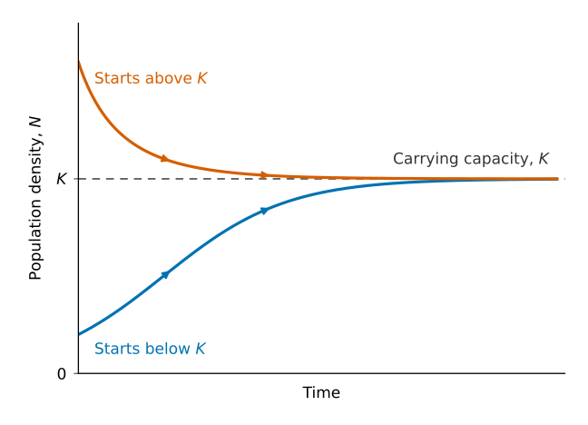{fig-alt="Graph of population density versus time. A blue curve increases from below carrying capacity, while an orange curve decreases from above it. Both approach the same horizontal dashed line labeled K."}
:::
:::::

## How much does a competitor count?

::::: columns
::: column
- A [competition coefficient]{.keyword} expresses the effect of another species relative to the effect of the focal species.
- Species 1: big bluestem.
- Species 2: smooth brome.
- $\alpha_{12}$: effect on big bluestem of smooth brome.
- $\alpha_{21}$: effect on smooth brome of big bluestem.
- First subscript: affected species.
- Second subscript: competitor.
:::

::: column
- If $\alpha_{12}=0.5$, one brome tiller has half the competitive effect on bluestem of one bluestem tiller.
- If $\alpha_{12}=1$, their effects on bluestem are equal.
- If $\alpha_{12}=2$, one brome tiller has twice the effect.
- If $\alpha_{12}=0$, brome has no competitive effect on bluestem.
- The two coefficients need not be equal.

If $\alpha_{12}=0.5$, how many bluestem equivalents do 40 brome tillers represent?
:::
:::::

::: notes
Question: If $\alpha_{12}=0.5$ , how many bluestem equivalents do 40 brome tillers represent?

Answer: 20. This describes their competitive effect on bluestem; it does not mean the brome tillers become bluestem or that 20 bluestem tillers necessarily die.
:::

## Add interspecific competition

::::: columns
::: column
The [Lotka–Volterra competition equations]{.keyword} extend logistic growth:

$$
\frac{dN_1}{dt}
=
r_1N_1\left(1-\frac{N_1+\alpha_{12}N_2}{K_1}\right)
$$

$$
\frac{dN_2}{dt}
=
r_2N_2\left(1-\frac{N_2+\alpha_{21}N_1}{K_2}\right)
$$
:::

::: column
- $N_1+\alpha_{12}N_2$: combined competitive load on big bluestem.
- Compare this load with $K_1$ to determine whether bluestem increases or decreases.
- We will measure grass density as live tillers per square metre.
- Numerical examples are hypothetical, not estimates from the RSC.
:::
:::::

With $K_1=100$, $N_1=60$, $N_2=40$, and $\alpha_{12}=0.5$, does bluestem increase or decrease?

::: notes
Question: With K1 = 100, N1 = 60, N2 = 40, and alpha12 = 0.5, does bluestem increase or decrease?

Answer: Increase. The competitive load is 60 + 0.5(40) = 80, below K1 = 100. The term in parentheses is positive.
:::

## A point represents two population densities

::::: columns
::: column
- A [phase plane]{.keyword} plots the two populations against each other.
- Horizontal axis: big bluestem density, $N_1$.
- Vertical axis: smooth brome density, $N_2$.
- One point represents both densities at one moment.
- Time is not an axis.

At $(60,40)$, which species is more abundant? Can we tell which is increasing?
:::

::: column
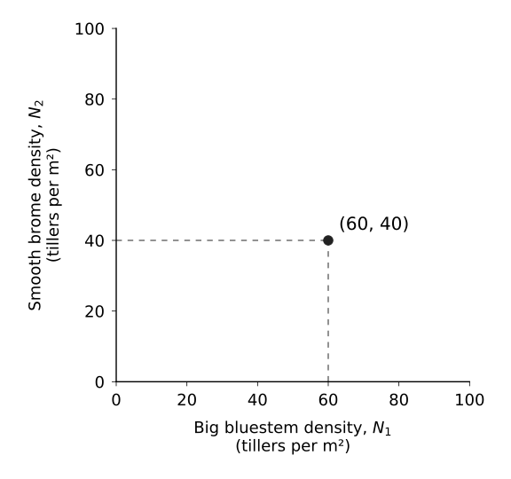{fig-alt="Phase plane with big bluestem density on the horizontal axis and smooth brome density on the vertical axis, both ranging from 0 to 100 tillers per square metre. A point labeled (60, 40) has dashed guides connecting it to 60 on the horizontal axis and 40 on the vertical axis."}
:::
:::::

::: notes
Questions: At (60,40), which species is more abundant? Can we tell which is increasing?

Answer: Big bluestem is more abundant: 60 versus 40 tillers per square metre. Coordinates alone do not tell us whether either population is increasing.
:::

## A trajectory shows change over time

::::: columns
::: column
- A [trajectory]{.keyword} connects successive states of the two populations.
- Each point along the path represents a different moment.
- Arrowheads indicate the direction of time.
- The same population changes can be shown as time series or as a phase-plane trajectory.
:::

::: column
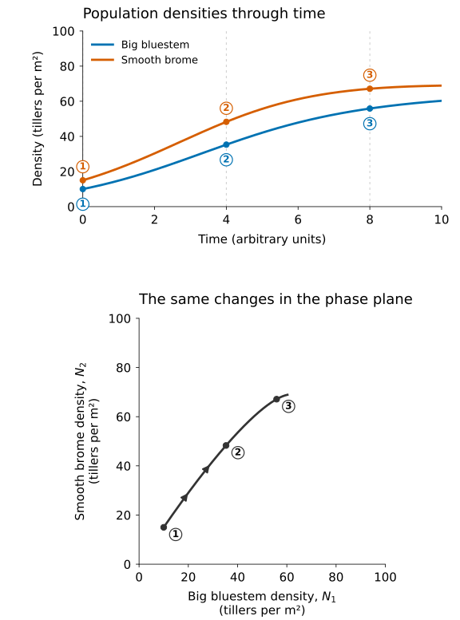{fig-alt="Two stacked graphs show increasing big bluestem and smooth brome densities. The upper graph plots both species against time, with bluestem in blue and brome in orange. Moments 1, 2, and 3 are marked on both curves. The lower graph plots brome density against bluestem density, combining each pair of densities into one point. Matching numbered points follow a curved trajectory upward and right, with arrowheads showing progression through time." width="60%"}
:::
:::::

## Arrows show immediate change

::::: columns
::: column
- Right: bluestem increases.
- Left: bluestem decreases.
- Up: brome increases.
- Down: brome decreases.
- Diagonal arrows combine changes in both populations.
- A [phase portrait]{.keyword} shows the pattern of movement across many starting points.

What does an arrow pointing straight up tell us about each population?
:::

::: column
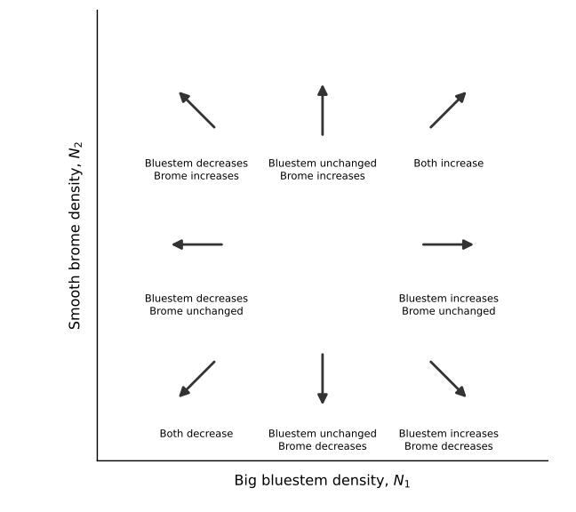{fig-alt="Eight labeled arrows on axes showing big bluestem density horizontally and smooth brome density vertically. Right and left indicate bluestem increasing and decreasing; up and down indicate brome increasing and decreasing. Horizontal arrows indicate unchanged brome density, and vertical arrows indicate unchanged bluestem density. Diagonal arrows combine increases or decreases in both species." width="70%"}
:::
:::::

::: notes
Question: What does an arrow pointing straight up tell us about each population?

Answer: Brome is increasing, while bluestem has zero instantaneous growth. It does not mean bluestem is absent.
:::

## Where does big bluestem have zero growth?

::::: columns
::: {.column width="60%"}
- A [zero-growth isocline]{.keyword} connects population combinations where one species neither increases nor decreases.
- For big bluestem, with $N_1>0$ and $r_1>0$:

$$
N_1+\alpha_{12}N_2=K_1
$$

- The combined competitive load equals bluestem’s carrying capacity.
- Intercepts: $K_1$ horizontally and $K_1/\alpha_{12}$ vertically.
- Below line: bluestem increases →, above line: bluestem decreases ←
- On the line: bluestem’s growth rate is zero at that moment; brome’s growth rate may not be.
:::

::: {.column width="40%"}
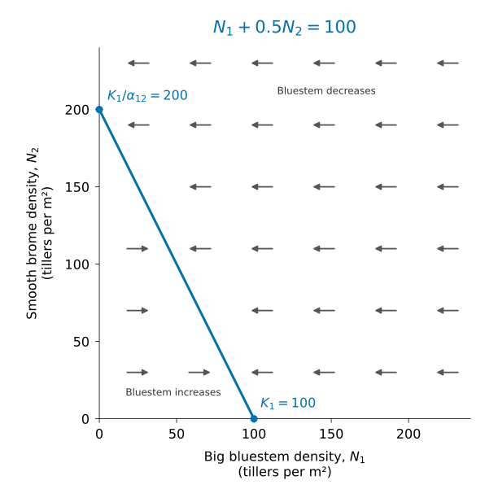{fig-alt="Phase plane with big bluestem density on the horizontal axis and smooth brome density on the vertical axis. A blue zero-growth isocline connects the vertical intercept at 200, labeled K1/alpha12, to the horizontal intercept at 100, labeled K1. Horizontal arrows point right below the line and left above it, indicating increasing and decreasing bluestem density, respectively." width="70%"}
:::
:::::

## Where does smooth brome have zero growth?

::::: columns
::: column
- For brome, with $N_2>0$:

$$
N_2+\alpha_{21}N_1=K_2
$$

- Horizontal intercept: $K_2/\alpha_{21}$.
- Vertical intercept: $K_2$.
- Below the line: brome increases.
- Above the line: brome decreases.
:::

::: column
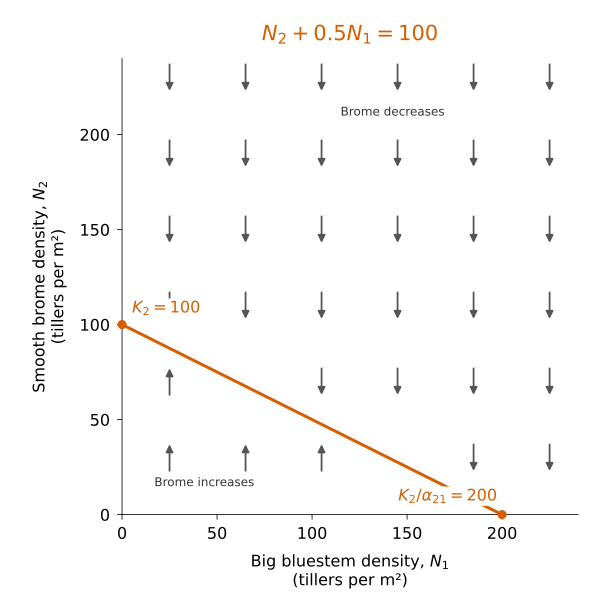{fig-alt="Phase plane with big bluestem density on the horizontal axis and smooth brome density on the vertical axis. An orange zero-growth isocline connects the vertical intercept at 100, labeled K2, to the horizontal intercept at 200, labeled K2/alpha21. Vertical arrows point up below the line and down above it, indicating increasing and decreasing brome density, respectively." width="70%"}
:::
:::::

## Combine the arrows

::::: columns
::: column
1.  Locate the starting point.
2.  Use bluestem’s isocline to determine left or right.
3.  Use brome’s isocline to determine up or down.
4.  Combine the two directions.

For points A and B, predict whether each population increases or decreases.
:::

::: column
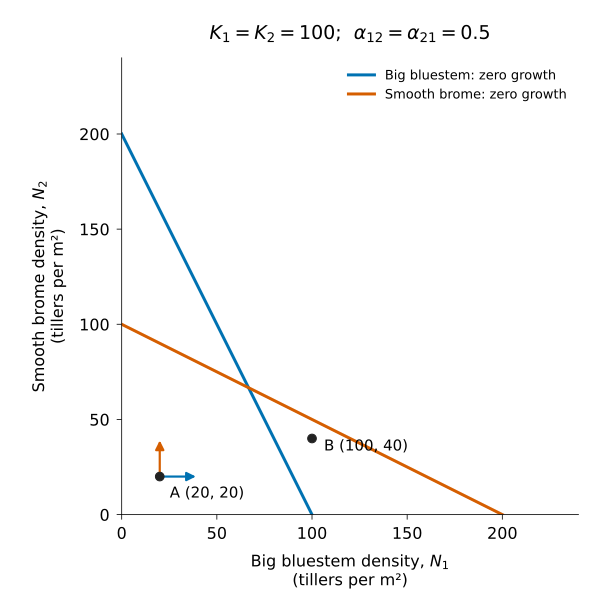{width="70%"}
:::
:::::

::: notes
Question: For points A and B, predict whether each population increases or decreases.

At A = (20,20), both increase. Each experiences a competitive load of 30, below its carrying capacity.

At B = (100,40), bluestem decreases because 100 + 0.5(40) = 120. Brome increases because 40 + 0.5(100) = 90.
:::

## Where is the equilibrium?

::::: columns
::: column
- At an [equilibrium]{.keyword}, neither population changes.
- At the intersection, both species have zero net growth.
- On just one species’ isocline, the other species can still change.
- Equilibria also occur on the axes, where one or both species are absent.

Does an intersection tell us whether nearby populations will move toward it?
:::

::: column
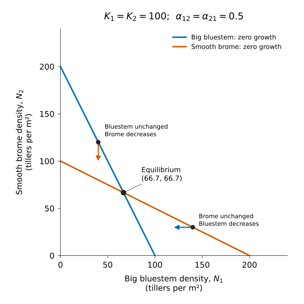{fig-alt="Phase plane with big bluestem density horizontally and smooth brome density vertically. Blue and orange zero-growth isoclines intersect at (66.7, 66.7), labeled equilibrium. At (40, 120) on bluestem’s isocline, a downward arrow shows brome decreasing while bluestem has zero instantaneous growth. At (140, 30) on brome’s isocline, a leftward arrow shows bluestem decreasing while brome has zero instantaneous growth." width="70%"}
:::
:::::

::: notes
Question: Does an intersection tell us whether nearby populations will move toward it?

Answer: No. The intersection identifies an equilibrium, but we must examine nearby movement to determine stability.
:::

## Stable coexistence: populations return

::::: columns
::: column
- Near a [stable equilibrium]{.keyword}, small displacements are followed by a return toward equilibrium.
- [Stable coexistence]{.keyword}: both populations persist at a stable positive equilibrium.
- Each species can increase when rare while the other is near its single-species carrying capacity.
- In this example: $K_1=K_2=100$ and $\alpha_{12}=\alpha_{21}=0.5$
- Each tiller affects its own species more strongly than the other species.
:::

::: column
[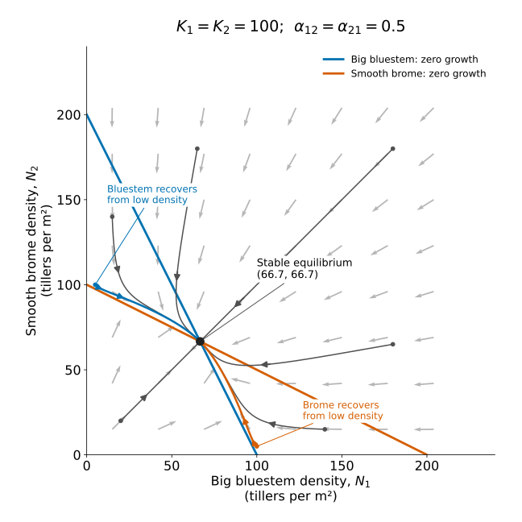{width="70%"}](Phase%20portrait%20with%20big%20bluestem%20density%20horizontally%20and%20smooth%20brome%20density%20vertically.%20Blue%20and%20orange%20zero-growth%20isoclines%20intersect%20at%20the%20stable%20equilibrium%20(66.7,%2066.7).%20Directional%20arrows%20and%20trajectories%20from%20several%20starting%20points%20converge%20on%20this%20intersection.%20Highlighted%20paths%20show%20bluestem%20recovering%20from%205%20tillers%20per%20square%20metre%20with%20brome%20initially%20at%20100,%20and%20brome%20recovering%20from%205%20with%20bluestem%20initially%20at%20100.)
:::
:::::

## Unstable coexistence: starting conditions matter

::::: columns
::: column
- Near an [unstable equilibrium]{.keyword}, at least some small displacements lead away from equilibrium.
- In this example: $K_1=K_2=100$ and $\alpha_{12}=\alpha_{21}=2$
- [Initial conditions]{.keyword} determine which species wins.
- [Priority effects]{.keyword} occur when arrival or establishment history influences the outcome.
:::

::: column
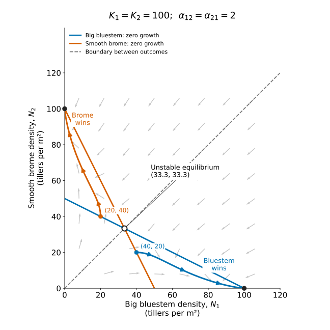{fig-alt="Phase portrait with big bluestem density horizontally and smooth brome density vertically. Blue and orange zero-growth isoclines intersect at the unstable equilibrium (33.3, 33.3). A dashed diagonal boundary follows equal densities. Below this boundary, a trajectory from (40, 20) approaches (100, 0), where bluestem excludes brome. Above it, a trajectory from (20, 40) approaches (0, 100), where brome excludes bluestem. Arrowheads indicate movement over time." width="70%"}
:::
:::::

## Four possible competitive outcomes

::::: columns
::: column
1.  Bluestem always excludes brome
2.  Brome always excludes bluestem
3.  Stable coexistence
4.  Either species wins, depending on initial conditions

The [competitive exclusion principle]{.keyword} predicts that species with identical niches cannot stably coexist under constant conditions.
:::

::: column
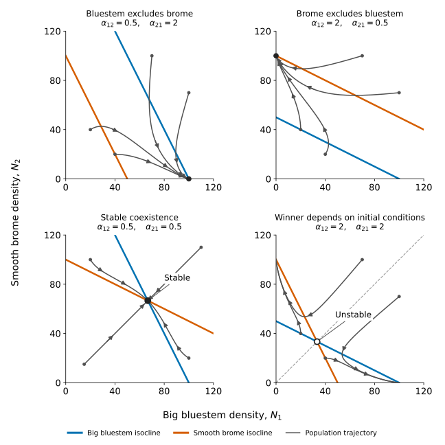{fig-alt="Four phase planes share axes from 0 to 120, with big bluestem density horizontally and smooth brome density vertically. Blue lines show bluestem’s zero-growth isoclines; orange lines show brome’s. Top left: trajectories approach bluestem alone at (100, 0). Top right: trajectories approach brome alone at (0, 100). Bottom left: trajectories converge on a stable intersection at approximately (66.7, 66.7). Bottom right: trajectories diverge from an unstable intersection at approximately (33.3, 33.3), approaching different winners on opposite sides of a dashed diagonal boundary." width="70%"}
:::
:::::

## What happens now—and eventually?

::::: columns
::: column
For each labeled starting point:

- Which population increases immediately?
- Which population decreases immediately?
- Will both species persist?
- Would changing the starting point change the eventual outcome?
:::

::: column
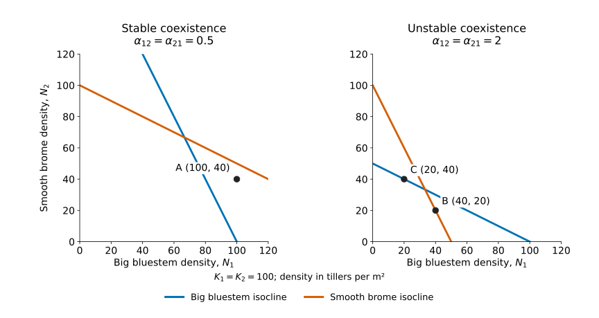{fig-alt="Two phase planes with matching axes from 0 to 120, showing big bluestem density horizontally and smooth brome density vertically. Blue lines represent bluestem’s zero-growth isoclines; orange lines represent brome’s. The left panel, labeled stable coexistence, marks A at (100, 40). The right panel, labeled unstable coexistence, marks B at (40, 20) and C at (20, 40). No trajectories or directional arrows are shown."}
:::
:::::

::: notes
Questions: For each point, which population increases or decreases immediately? Will both persist? Would changing the starting point change the eventual outcome?

A: Bluestem decreases and brome increases. Both approach stable coexistence. Other starting points with both species present approach the same equilibrium.

B: Bluestem initially increases; brome has zero instantaneous growth because B lies on brome’s isocline. As bluestem increases, brome begins decreasing. Bluestem eventually excludes brome.

C: Brome initially increases; bluestem has zero instantaneous growth because C lies on bluestem’s isocline. As brome increases, bluestem begins decreasing. Brome eventually excludes bluestem.

In the unstable system, changing initial conditions can change the winner.
:::

## Conditions can change the outcome

::::: columns
::: column
- [Environmental heterogeneity]{.keyword}: conditions vary across space or time.
- Different conditions can favor different competitors.
- In this hypothetical example, brome’s effect on bluestem decreases: $\alpha_{12}$ changes from 2 to 0.5.
- Bluestem’s isocline shifts; brome’s isocline stays unchanged.
- The predicted outcome changes from brome excluding bluestem to stable coexistence.
:::

::: column
{fig-alt="Two phase planes show big bluestem density horizontally and smooth brome density vertically. In Condition A, trajectories approach (0, 100), where brome excludes bluestem. In Condition B, bluestem’s blue isocline shifts upward as alpha12 decreases from 2 to 0.5; brome’s orange isocline remains unchanged. Trajectories converge on a stable equilibrium at approximately (66.7, 66.7). The panels represent hypothetical scenarios."}
:::
:::::

## How would we test the role of competition?

::::: columns
::: column
- Grow bluestem alone, brome alone, and both species together under the same conditions.
- Replicate each treatment and measure growth, survival, or tiller production.
- Compare each species’ performance alone versus with its competitor.

If bluestem disappears when grown with brome, what comparison would help determine whether competition caused its loss?
:::

::: column
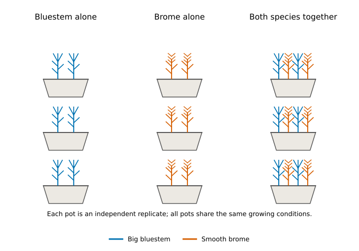{fig-alt="Diagram of three treatments, each containing three replicate pots. Bluestem-alone pots contain two blue bluestem symbols; brome-alone pots contain two orange brome symbols. Mixed pots contain two of each species. Each pot is an independent replicate grown under the same conditions." width="100%"}
:::
:::::

::: notes
Answer: Compare bluestem alone versus with brome under the same conditions. If bluestem persists alone but performs worse or disappears with brome, that supports a competitive effect. Without the wet bluestem-alone treatment, unsuitable conditions remain an alternative explanation.
:::
