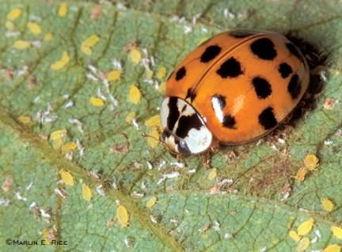
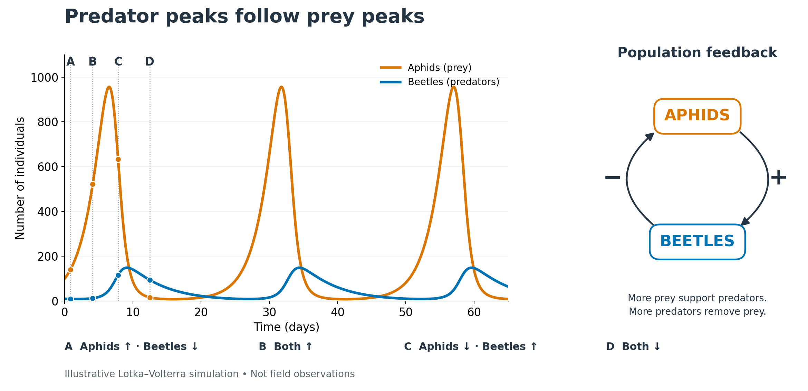
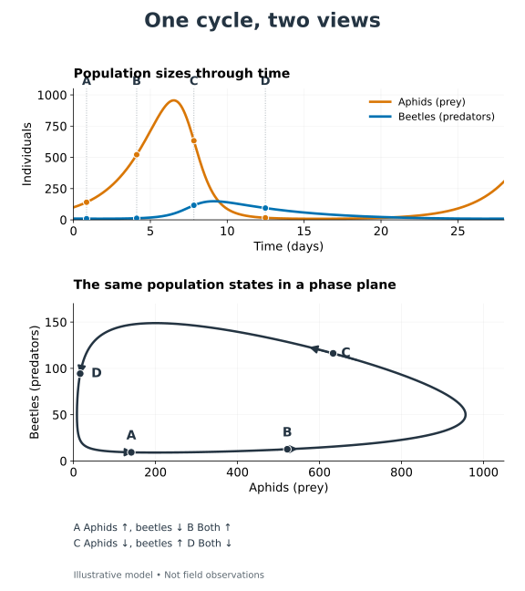
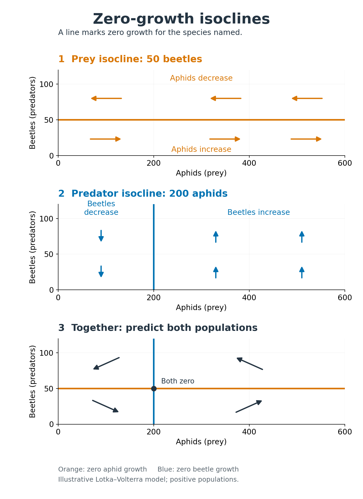
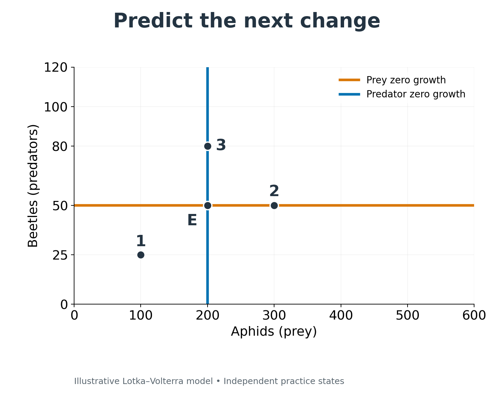
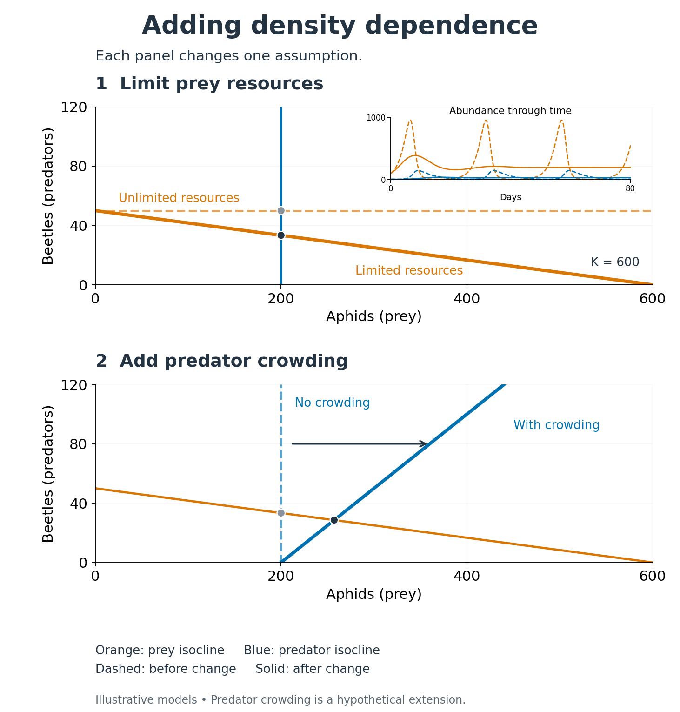
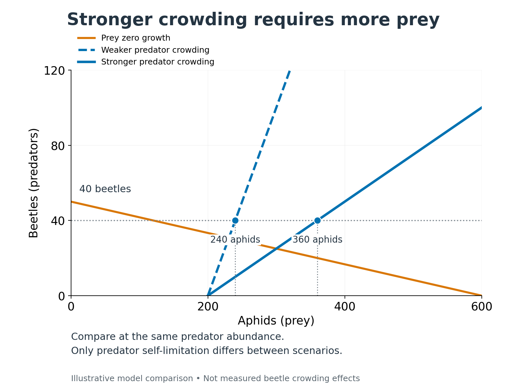
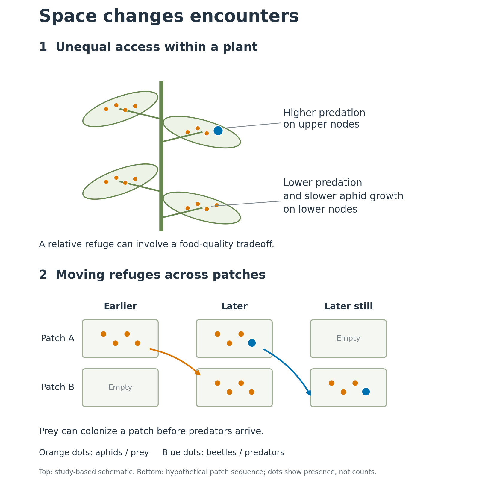

## Species interactions

**Effects on survival and reproduction:** + benefits, − harms, 0 has no detectable effect.

| Effect on species A ↓ / species B → | **−** | **0** | **+** |
|:---|:--:|:--:|:--:|
| **−** | Competition | Amensalism | **Exploitation** |
| **0** | Amensalism | Neutralism | Commensalism |
| **+** | **Exploitation** | Commensalism | Mutualism |

**Today: exploitation, where one species benefits and the other is harmed.**

## One hare, several exploitative interactions

| Interaction | Example | What happens? |
|:-----------------------|:-----------------------|:-----------------------|
| **Herbivory** | Hare eats willow | Consumes living plant tissue; may or may not kill the plant. |
| **Parasitism** | Tapeworm lives in hare | Feeds in or on a host, usually without immediately killing it. |
| **Predation** | Coyote eats hare | Kills and consumes prey. |

**Does an exploiter have to kill its victim to affect its population?**

::: notes
- Answer: no. Reduced growth, survival, or reproduction can change population growth without immediate death.
- One species can play several roles: the hare is an herbivore, prey, and a parasite host.
- Endoparasites live inside hosts; ectoparasites live on their exterior. Internal habitats are relatively stable, but parasites must cope with host defenses and transmission. Exterior habitats expose parasites to environmental variation and predators.
- Parasitoids develop in or on a host and ultimately kill it. Hyperparasites exploit other parasites.
- Categories overlap: seed predators are herbivores that kill individual plants at the seed stage.
- Keep this review brief: all 18 completers answered the three Part 1 quiz questions correctly.
:::

## Effects extend beyond the victim

::::: columns
::: {.column width="42%"}
- Goldenrod competes with other plants for space and light.
- Insect herbivores suppress goldenrod.
- Other plant species can then persist.

**Predict: What happens to plant diversity when the insects are removed?**
:::

::: {.column width="58%"}
{fig-alt="Photographs and a graph compare plots with insect herbivores to insecticide-treated plots. Plots with herbivores have shorter, more diverse vegetation and higher plant species richness. Treated plots have taller goldenrod and lower richness." height="410"}
:::
:::::

::: notes
- Prediction: removing insects allows goldenrod to dominate and reduces plant diversity.
- Explain the indirect effect: insects harm goldenrod, but other plants benefit from reduced competition. Their direct interaction with goldenrod remains exploitative.
- The study manipulated insects using insecticide rather than removing only one beetle species. Avoid claiming that the treatment isolated only the goldenrod leaf-miner.
- Connect this result to the previous competition lecture and students' ecosystem diagrams for Invasion!.
- Plants can resist herbivory chemically, mechanically, or through low nutritional quality. Tolerance allows regrowth despite damage. These responses help determine the strength of the effect.
- Figure and example: assigned SimUText chapter, Part 1, drawing on Carson and Root's experiment.
:::

## Find an unexpected interaction

::::: columns
::: {.column width="50%"}
**Groups of 2–3 · 10 minutes · Submit one slide**

Find an unusual example involving **predation, herbivory, or parasitism**.

Include:

- Organism names and **1–2 photos**.
- Who benefits, who is harmed, and how.
- What makes the interaction unexpected or interesting
- Be ready to share in lightning presentation minute.
:::

::: {.column width="50%"}
Choose a starting point—or find your own:

- A parasite that changes its host’s behavior or appearance.
- A plant that recruits animals for protection.
- An organism that exploits another exploiter.
- A surprising predator–prey relationship.
:::
:::::

## Can beetles contain an aphid outbreak?

::::: columns
::: {.column width="40%"}
**Soybean aphid** (*Aphis glycines*) and **Asian lady beetle** (*Harmonia axyridis*)

**What determines whether predators keep aphids under control?**
:::

::: {.column width="60%"}
{fig-alt="Orange Asian lady beetle with black spots feeding among pale green soybean aphids clustered on a plant stem."}
:::
:::::

## The prey equation

::::: columns
::: {.column width="45%"}
**More prey and more predators mean more encounters.**

- $N_{\text{prey}}N_{\text{predator}}$ represents opportunities for encounters.
- $a$ scales how effectively predators find and capture prey.
- Together, $aN_{\text{prey}}N_{\text{predator}}$ gives **prey consumed per unit time**.

**Consumption removes individuals from the prey population.**
:::

::: {.column width="55%"}
$$
\frac{dN_{\text{prey}}}{dt}
=
\underbrace{r_{\text{prey}}N_{\text{prey}}}_{\text{growth without predators}}
-
\underbrace{aN_{\text{prey}}N_{\text{predator}}}_{\text{prey consumed}}
$$

**Predict:** If beetle abundance doubles while aphid abundance stays the same, what happens to consumption?
:::
:::::

## The predator equation

::::: columns
::: {.column width="45%"}
**The prey lost become food for predators.**

- $aN_{\text{prey}}N_{\text{predator}}$ is the **same consumption rate** as in the prey equation.
- $b$ converts consumed prey into **new predators**.
- Subtract predator deaths to find **net population change**.

**The same feeding events link both populations.**
:::

::: {.column width="55%"}
$$
\frac{dN_{\text{predator}}}{dt}
=
\underbrace{abN_{\text{prey}}N_{\text{predator}}}_{\text{new predators produced}}
-
\underbrace{mN_{\text{predator}}}_{\text{predator deaths}}
$$

**Check:** Feeding supports 4 new beetles per day; 6 beetles die per day.

**What is the net change? Which term represents the 4?**
:::
:::::

## Why populations cycle

::::: columns
::: {.column width="40%"}
**Prey and predator populations affect one another.**

- More aphids support beetle population growth.
- More beetles increase aphid consumption.

**At C, aphids are declining but beetles are still increasing. Why?**
:::

::: {.column width="60%"}
{alt="Illustrative Lotka–Volterra cycles show predator peaks following prey peaks. Letters identify four combinations of population growth and decline. These are simulated abundances, not field observations." fig-alt="Orange aphid and blue beetle abundance curves cycle through time. At A, aphids increase and beetles decline; B, both increase; C, aphids decline and beetles increase; D, both decline. A feedback diagram shows aphids positively affecting beetles and beetles negatively affecting aphids."}
:::
:::::

## One cycle, two views

::::: columns
::: {.column width="40%"}
**Each point records both populations at one time.**

**Find state C in both views. What is changing?**
:::

::: {.column width="60%"}
{alt="The same simulated predator–prey cycle shown through time and in a phase plane. A–D identify identical population states in both plots and match slide 8." fig-alt="Above, orange aphid and blue beetle abundances fluctuate through time. Below, the corresponding phase trajectory moves counterclockwise. Matching points A–D show prey increasing and predators decreasing, both increasing, prey decreasing and predators increasing, and both decreasing, respectively."}
:::
:::::

## Two zero-growth isoclines

::::: columns
::: {.column width="40%"}
**Prey zero growth**

$$ N_{\text{predator}}=\frac{r_{\text{prey}}}{a} $$

**Predator zero growth**

$$ N_{\text{prey}}=\frac{m}{ab} $$
:::

::: {.column width="60%"}
{alt="Zero-growth isoclines separate population increase from decline. Aphid growth is zero at 50 beetles; beetle growth is zero at 200 aphids. Both populations have zero growth at their intersection." fig-alt="Three matching phase planes show the horizontal orange prey isocline, the vertical blue predator isocline, and both together. Aphids increase below their isocline and decline above it. Beetles increase to the right of their isocline and decline to its left. Combined arrows indicate each population’s direction of change."}
:::
:::::

## Predict the next change

::::: columns
::: {.column width="40%"}
**At 1, 2, and 3: which population increases, decreases, or stays unchanged?**

**What happens at E?**
:::

::: {.column width="60%"}
{fig-alt="Phase plane with a horizontal orange prey isocline at 50 beetles and vertical blue predator isocline at 200 aphids. Point 1 is at (100,25), point 2 at (300,50), point 3 at (200,80), and E at their intersection, (200,50)."}
:::
:::::

## Prey compete; predators interfere

::::: columns
::: {.column width="40%"}
**Limited plant resources reduce aphid growth.**

**Crowding can reduce beetle population growth.**
:::

::: {.column width="60%"}
{fig-alt="Two phase planes show successive model changes. Above, limited prey resources replace the horizontal prey isocline with a downward-sloping line; an inset contrasts persistent cycles with damped oscillations. Below, predator crowding replaces the vertical predator isocline with an upward-sloping line while the prey isocline remains unchanged."}
:::
:::::

## Why crowding changes predator growth

::::: columns
::: {.column width="40%"}
**At the same beetle abundance, which population needs more aphids to stop declining?**
:::

::: {.column width="60%"}
{fig-alt="Phase plane with an orange prey isocline and two blue predator isoclines. A horizontal guide at 40 beetles intersects the dashed weaker-crowding isocline at 240 aphids and the solid stronger-crowding isocline at 360 aphids."}
:::
:::::

## Refuges and moving populations

::::: columns
::: {.column width="40%"}
**Predators do not encounter every prey individual equally.**

**Can populations persist across patches even when some patches lose them?**
:::

::: {.column width="60%"}

:::
:::::

## Small populations can disappear

**Very small populations are vulnerable to chance events.**

- Deterministic models can retain positive abundances indefinitely.
- Real populations contain whole individuals: a few deaths or failed reproduction can eliminate the last survivors.

**Persistence in a model does not guarantee persistence in nature.**

## More feeding or more predators?

More prey can produce two different responses:

- **Functional response:** each predator eats more prey per unit time.
- **Numerical response:** predator abundance increases through reproduction or immigration.

**Total consumption = feeding per predator × number of predators.**

Which response occurs when beetles move into an aphid-infested field?

## Three functional responses

How does feeding per predator change as prey become more abundant?

- **Type I:** consumption rises proportionally.
- **Type II:** consumption rises, then levels off because handling takes time.
- **Type III:** consumption initially rises slowly, then accelerates, and finally levels off.

Switching, learning, or limited refuges can produce a **type III** response.

## A beetle cannot eat indefinitely

**Finding prey and handling prey both take time.**

- With few aphids, beetles spend more time searching.
- With many aphids, handling limits further consumption.

Lady beetles feeding on soybean aphids showed a **type II response** in laboratory experiments.

**More aphids do not necessarily mean proportionally more aphids eaten.**

## Conditions change feeding rates

**Feeding responses depend on environmental conditions.**

In an experiment with lady beetles feeding on **pea aphids**:

- Warmer conditions increased consumption over the tested range.
- The response remained **type II**.

**A feeding rate can change without changing the response type.**

## Can predators contain the outbreak?

Predator control depends on:

- **Prey growth:** how quickly aphids increase.
- **Predator abundance:** reproduction, survival, and movement.
- **Feeding capacity and access:** how many aphids each beetle can find and consume.

**Effective control requires total prey losses to keep pace with prey production.**

What would you measure before deciding whether intervention is needed?
