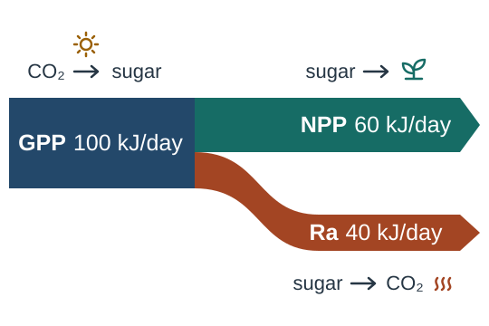

## An [ecosystem]{.keyword} is a community of organisms interacting with one another and with their physical environment

::::: columns
::: {.column width="50%"}
- [Abiotic]{.keyword} (nonliving)
  - **Resources** · water, light, and nutrients
  - **Ambient environment** · conditions such as temperature and salinity
  - **Disturbance regimes** · patterns of fires, floods, and storms
- [Biotic]{.keyword} (living organisms and their effects)
  - **Biotic interactions** · competition, predation, and mutualism
  - **Human activity** · resource use, habitat alteration, and movement of species
:::

::: {.column width="50%"}
.](images/ecosystem-biotic-abiotic-drivers.webp){fig-alt="Conceptual diagram with ecosystem properties at the center. Arrows link those properties to abiotic drivers such as resources and disturbance, and to biotic drivers such as species interactions and human activities." fig-align="center" width="630"}
:::
:::::

## Energy flows through ecosystems, Nutrients cycle

::::: columns
::: {.column width="50%"}
[Ecosystem ecology]{.keyword} is the study of how energy flows and matter cycles through ecosystems.

- **Energy flows**
  - In most ecosystems, energy enters as sunlight.
  - It passes through organisms and eventually leaves as heat.
- **Nutrients cycle**
  - Organisms take up nutrients from their environment.
  - Decomposition makes those nutrients available again.
:::

::: {.column width="50%"}
.](images/odum-energy-flow-nutrient-cycling.png){fig-alt="Energy flows from absorbed sunlight through autotrophs and heterotrophs, with heat released along the way. Nutrients cycle between organisms and a nutrient pool, with separate arrows for imports and exports." fig-align="center"}
:::
:::::

## Autotrophs use light or chemical energy to build organic matter

::::: columns
::: {.column width="50%"}
[Primary production]{.keyword} is the rate at which [autotrophs]{.keyword} make organic matter from inorganic materials such as carbon dioxide.

- [Photosynthesis]{.keyword}
  - Uses energy from sunlight.
  - Powers primary production in most ecosystems.
- [Chemoautotrophy]{.keyword}
  - Uses energy released by oxidizing inorganic substances such as hydrogen sulfide.
  - Supports primary production in places such as deep-sea hydrothermal vents.
:::

::: {.column width="50%"}
.](images/noaa-chemosynthesis-diagram.jpg){fig-alt="Diagram showing how microbes use energy released by chemical reactions to convert carbon dioxide into organic matter at hydrothermal vents and cold seeps."}
:::
:::::

## A [Sankey diagram]{.keyword} accounts for where energy goes

::::: columns
::: {.column width="50%"}
In a Sankey diagram, wider arrows represent greater flows of energy.

- [First law of thermodynamics]{.keyword}
  - Energy is conserved. The branches together account for the incoming energy.
- [Second law of thermodynamics]{.keyword}
  - Energy transformations disperse some energy as heat.
  - Ecosystems need a continuing input of usable energy.
:::

::: {.column width="50%"}
.](images/zhu-et-al-2008-photosynthesis-energy-budget.png){fig-alt="Energy budget starting with 1,000 kJ of sunlight. The diagram shows energy unavailable for photosynthesis, energy reflected or transmitted, and losses during conversion and respiration. Under the modeled conditions, 46 kJ remains stored in C₃ plant biomass and 60 kJ in C₄ plant biomass."}
:::
:::::

## Net primary production is what remains after producers respire

::::: columns
::: {.column width="50%"}
$$
\mathrm{NPP} = \mathrm{GPP} - R_a
$$

- [Gross primary production]{.keyword} ($\mathrm{GPP}$) — rate at which producers capture and store energy.
- [Autotrophic respiration]{.keyword} ($\mathrm{Ra}$) — rate at which producers use stored energy to power cellular work.
- [Net primary production]{.keyword} ($\mathrm{GPP}$) — rate at which producers store energy in new organic matter after respiration.

**Example** · A plant captures 100 kJ per day and uses 40 kJ per day in respiration. Its NPP is **60 kJ per day**.
:::

::: {.column width="50%"}
{fig-alt="A wide GPP band splits into a 60 kJ/day NPP band and a 40 kJ/day Ra band. Icons show sunlight driving sugar production, sugar supporting plant growth, and respiration releasing carbon dioxide and heat." fig-align="center" width="100%"}
:::
:::::

## What does your diet contribute to your ecological footprint?

::::: columns
::: {.column width="50%"}
An [ecological footprint]{.keyword} estimates how much biologically productive land and water it takes to supply the resources we use and absorb the waste we generate.

- **Example · The food we eat**
  - Producing food takes land for crops and grazing.
  - In this UK study, diets with less meat were associated with less land use.

**Look at the land-use panel.** How does the low-meat group compare with the high-meat group?
:::

::: {.column width="50%"}
.](images/scarborough-et-al-2023-diet-environmental-impacts.png){fig-alt="Plots compare the estimated environmental impacts of vegan, vegetarian, fish-eating, and meat-eating diets. In the land-use panel, the low-meat group uses less than half as much land as the high-meat group based on the point estimates." width="505"}
:::
:::::

## Net CO₂ uptake reflects both photosynthesis and respiration

::::::: {.columns style="margin-top: 1.2em;"}
:::: {.column width="50%" style="box-sizing: border-box; padding-right: 0.8em;"}
[Photosynthesis]{.keyword}

Takes up CO₂ and stores energy in sugars.

::: {style="font-size: 0.85em; margin-top: 0.9em;"}
$\displaystyle 6\mathrm{CO_2} + 6\mathrm{H_2O} + \text{solar energy} \rightarrow \mathrm{C_6H_{12}O_6} + 6\mathrm{O_2}$
:::
::::

:::: {.column width="50%" style="box-sizing: border-box; padding-left: 0.8em; border-left: 1px solid #c9ced3;"}
[Cellular respiration]{.keyword}

Releases CO₂ and makes energy available for cellular work.

::: {style="font-size: 0.85em; margin-top: 0.9em;"}
$\displaystyle \mathrm{C_6H_{12}O_6} + 6\mathrm{O_2} \rightarrow 6\mathrm{CO_2} + 6\mathrm{H_2O} + \text{energy for work}$
:::
::::
:::::::

::: {style="text-align: center; margin-top: 1.4em; padding-top: 0.8em; border-top: 1px solid #c9ced3;"}
**Net CO₂ uptake** = CO₂ taken up by photosynthesis − CO₂ released by respiration
:::

## A branch enclosure lets us measure CO₂ exchange

::::: columns
::: {.column width="50%"}
Enclose a leafy branch in a clear bag and track how the CO₂ concentration inside changes.

1.  **Clear bag in daylight.** Photosynthesis takes up CO₂ and respiration releases it. The change in CO₂ shows the branch’s **net exchange**.
2.  **Same bag, covered to block light.** Photosynthesis stops and respiration continues. How quickly CO₂ builds up tells us the branch’s [autotrophic respiration]{.keyword} (**Ra**).
:::

::: {.column width="50%"}
, [CC BY 4.0](https://creativecommons.org/licenses/by/4.0/).](images/conifer-branch-enclosure.png){fig-alt="A clear plastic bag supported by a white ring encloses a conifer branch. Tubing connects to the bag for gas sampling." fig-align="center" width="601"}
:::
:::::

## Flux towers measure net CO₂ exchange across an ecosystem

::::: columns
::: {.column width="50%"}
A [flux tower]{.keyword} estimates how much CO₂ moves between an ecosystem and the atmosphere per unit area per unit time.

- Sensors above the vegetation measure CO₂ concentration and vertical wind speed.
- Together, these measurements show whether the ecosystem is taking up or releasing CO₂ overall.
- **NEON** (National Ecological Observatory Network) collects and shares data from flux towers across the U.S. The closest to Moorhead is at **Dakota Coteau Field Site** in Stutsman County, North Dakota.
:::

::: {.column width="50%"}
.](images/neon-dakota-coteau-flux-tower.jpg){fig-alt="Field technicians walk through rolling grassland toward a flux tower at NEON’s Dakota Coteau site."}
:::
:::::

## Net ecosystem production accounts for all respiration

A flux tower measures the combined CO₂ exchange of the whole ecosystem. Plants take up CO₂ through photosynthesis, while plants, animals, and microbes release it through respiration.

- [Ecosystem respiration]{.keyword} (**Re**) combines:
  - **Ra** · respiration by producers
  - **Rh** · [heterotrophic respiration]{.keyword} by consumers and decomposers

$$
\mathrm{Re} = \mathrm{Ra} + \mathrm{Rh}
$$

[Net ecosystem production]{.keyword} (**NEP**) is gross primary production minus ecosystem respiration.

$$
\mathrm{NEP} = \mathrm{GPP} - \mathrm{Re}
$$

## NPP and NEP start with the same GPP

Suppose **GPP = 100**, **Ra = 40**, and **Rh = 20**, all in the same units.

::::: columns
::: {.column width="50%" style="box-sizing: border-box; padding-right: 0.8em;"}
[**Net primary production**]{.keyword} **(NPP)**

Subtract respiration by **producers**.

$$
\begin{aligned}
\mathrm{NPP} &= \mathrm{GPP} - \mathrm{Ra} \\
             &= 100 - 40 = \mathbf{60}
\end{aligned}
$$
:::

::: {.column width="50%" style="box-sizing: border-box; padding-left: 0.8em; border-left: 1px solid #c9ced3;"}
[**Net ecosystem production**]{.keyword} **(NEP)**

Subtract respiration by **producers and heterotrophs**.

$$
\begin{aligned}
\mathrm{NEP} &= \mathrm{GPP} - (\mathrm{Ra} + \mathrm{Rh}) \\
             &= 100 - (40 + 20) = \mathbf{40}
\end{aligned}
$$
:::
:::::

## Nighttime CO₂ release helps us estimate daytime GPP

$$
\mathrm{GPP}_{\text{day}} = \mathrm{NEP}_{\text{day}} + \mathrm{Re}_{\text{day}}
$$

::::: columns
::: column
**At night**

- Without sunlight, **GPP ≈ 0**.
- Net CO₂ release gives an estimate of **ecosystem respiration (Re)**.
:::

::: column
**During the day**

- Net CO₂ uptake estimates **NEP**.
- Use the nighttime relationship between temperature and respiration to estimate **daytime Re**.
- Add that estimate back to recover **GPP**.
:::
:::::

## Light and dark bottles separate photosynthesis from respiration

Fill two bottles with water from the same lake or ocean sample. Measure [dissolved oxygen]{.keyword} (**O₂**) at the start and after the same amount of time.

::::: columns
::: column
**Light bottle**

- Photosynthesis adds O₂.
- Respiration consumes O₂.
- The net change in O₂ estimates **NEP**.
:::

::: column
**Dark bottle**

- An opaque wrap blocks light, stopping photosynthesis.
- Respiration continues to consume O₂.
- The decrease in O₂ estimates **Re**.
:::
:::::
