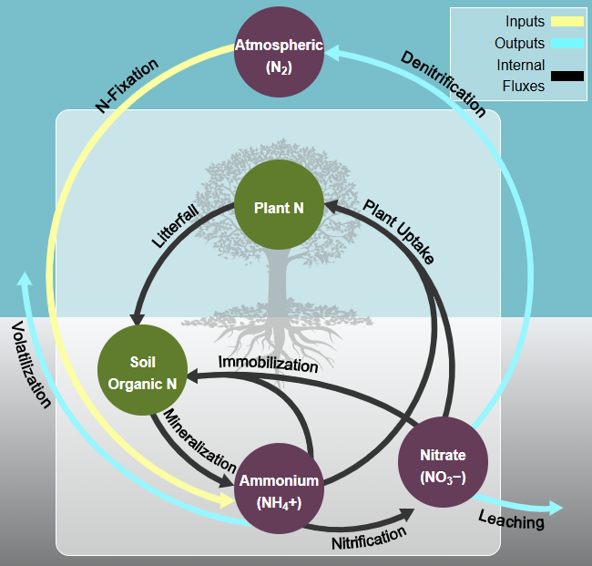
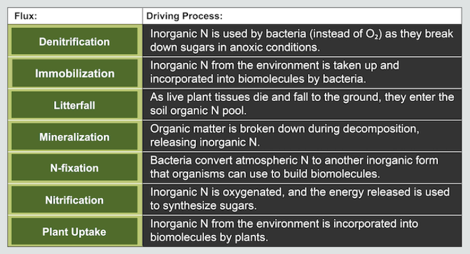

# Nutrient cycling fundamentals

## Macronutrients and micronutrients differ in how much organisms need

- A [nutrient]{.keyword} is a substance an organism needs to grow and function.
- [Macronutrients]{.keyword} are needed in large amounts. C, H, and O form sugars and other cell materials. N is part of proteins and DNA, P is part of DNA and ATP, and S is part of some amino acids.
- [Micronutrients]{.keyword} are needed in small amounts. For example, cells use iron in proteins that transfer electrons.

## Matter cycles and energy flows

- A [biogeochemical cycle]{.keyword} is the movement of an element among organisms and the physical environment. In a forest, carbon moves from air into trees and returns to the air as CO₂.
- Energy enters the forest as sunlight, is stored temporarily in sugars and other molecules, and leaves as heat.
- An [open nutrient cycle]{.keyword} exchanges matter across the study boundary. Carbon can leave a forest in streamwater. A [closed nutrient cycle]{.keyword} has no exchange across its boundary. At the scale of Earth, the carbon cycle is approximately closed.

## Net flux determines whether a pool grows or shrinks

- A [pool]{.keyword} is the amount stored in a place or form. A [flux]{.keyword} is the amount transferred per unit time.
- [Storage rate]{.keyword} = total inflow − total outflow. If soil gains 12 kg P/yr and loses 8 kg P/yr, the pool grows by **4 kg P/yr**.
- At steady state, inflow equals outflow. If both are 8 kg P/yr and the pool holds 80 kg P, the **average residence time** is 80 kg ÷ 8 kg/yr = **10 years**.

## Forest carbon moves from air to trees and back

- During [photosynthesis]{.keyword}, trees use light energy to turn CO₂ ([inorganic]{.keyword} carbon) and water into sugars ([organic]{.keyword} carbon). They release O₂.
- [Litterfall]{.keyword} transfers carbon from trees to the forest floor as leaves, twigs, and other dead material.
- During aerobic [respiration]{.keyword}, trees and microbes use O₂ to obtain energy from organic compounds and release CO₂ back into the air.

## Phosphorus cycles through rock, soil, and organisms

- [Weathering]{.keyword}, the breakdown of rock, releases phosphate into soil and water.
- [Plant uptake]{.keyword} moves dissolved phosphate into roots. Plants incorporate it into molecules such as DNA.
- [Mineralization]{.keyword} converts nutrients in dead material and waste into mineral forms. Microbes release phosphate that roots can absorb again.

## A nutrient addition can reveal what limits growth

- A [limiting nutrient]{.keyword} is in short enough supply that adding it increases growth.
- A [nutrient addition bioassay]{.keyword} tests growth after adding nutrients. Compare replicated lake-water samples with **no addition, +N, +P, and +N+P** under the same conditions.
- Growth after +P alone points to P limitation. Growth only after +N+P indicates [co-limitation]{.keyword}, where growth requires both additions.

## Nutrient enrichment can lead to low oxygen

- A [watershed]{.keyword} is the land area draining to a common outlet. Rain can carry nutrients from farms in the Mississippi River watershed to the Gulf of Mexico.
- [Eutrophication]{.keyword} is nutrient enrichment that can stimulate excessive growth of aquatic producers.
- Microbes consume oxygen as they break down dead cells from the bloom. [Hypoxia]{.keyword} is low dissolved oxygen.

# Ecosystem-level nutrient cycles

## Microbes convert nitrogen among chemical forms

- [Nitrogen fixation]{.keyword} converts N₂ gas to ammonia, which can form ammonium (NH₄⁺). Root-associated microbes do this in clover.
- [Nitrification]{.keyword} converts NH₄⁺ to nitrite (NO₂⁻) and then nitrate (NO₃⁻).
- [Denitrification]{.keyword} converts NO₃⁻ to gases such as N₂, especially where oxygen is scarce.

## Plants and microbes bring mineral nitrogen into living tissue

- Roots absorb NH₄⁺ or NO₃⁻ and use the nitrogen to build proteins.
- [Immobilization]{.keyword} occurs when microbes take up mineral nitrogen and incorporate it into their cells.
- When organisms die or release waste, [mineralization]{.keyword} converts nitrogen in that material back to NH₄⁺.

## Nitrogen Cycle Diagram

::::: columns
::: {.column width="40%"}

:::

::: {.column width="60%"}

:::
:::::

## Water carries nutrients from uplands to lakes

- Gravity moves water downhill and through soils. [Leaching]{.keyword} is the removal of dissolved material by percolating water. For example, NO₃⁻ can move below roots and reach streams.
- Evapotranspiration is water loss by evaporation and from plants. It reduces the water available to carry nutrients downstream.
- In lakes, dead cells sink, microbes release nutrients at depth, and mixing can return those nutrients to surface waters.

## Paired watersheds reveal the effects of forest disturbance

- Compare stream nutrient export from two drainage areas before and after treating one. The untreated area shows how export changes without treatment.
- At Hubbard Brook, clearcutting and suppressing regrowth reduced root uptake. More nitrate left in streamwater.
- [Acid rain]{.keyword} is rain made more acidic by pollutants such as sulfur dioxide and nitrogen oxides. At Hubbard Brook, acidic water displaced calcium and magnesium from soils and increased their loss in drainage water.

# Nutrient budgets

## Storage and retention answer different questions

- A full [nutrient budget]{.keyword} accounts for all transfers across the chosen boundary. If 100 kg N/yr enters, 30 leaves in the stream, and 20 leaves as gas, **50 kg N/yr accumulates**.
- A [modified nutrient budget]{.keyword} compares selected inflows with stream export. If selected inflows total 100 kg N/yr and stream export is 30, the estimated [retention rate]{.keyword} is **70 kg N/yr**.
- [Retention efficiency]{.keyword} is that difference as a percentage of the selected inflows. Here it is **70%**. The 70 includes nitrogen lost by other routes.

## Reduce nutrient losses along their main pathways

- Nitrate often travels dissolved in water. Match fertilizer application to crop demand or use wetlands where microbes can convert nitrate to N₂.
- Phosphorus often travels attached to eroded soil. Maintain ground cover to slow erosion. Where dissolved phosphorus is important, reduce excess phosphorus applications.

# Global biogeochemical cycles

## Humans move carbon, nitrogen, and phosphorus into active circulation

- [Active reserves]{.keyword} are stores that exchange an element on ecological timescales. Key mineral forms include CO₂ in air, dissolved carbon in oceans, mineral N in soil and water, and phosphate in rock and soil.
- **C** · Burning coal, oil, and gas transfers stored carbon from rock to air as CO₂. Land clearing releases carbon stored in vegetation and soils.
- **N** · Industrial ammonia production and legume farming convert more N₂ to forms organisms can use. Combustion also produces nitrogen oxides.
- **P** · Mining phosphate rock transfers phosphorus to farm soils. Some moves down rivers to the ocean and accumulates in sediments.

## Compare transfers to see where nutrients accumulate

- Track exchanges among **air, land, oceans, and rocks**. The global total can stay the same while individual stores grow or shrink.
- In SimUText’s preindustrial and modern N budgets, industrial fertilizer production adds a new transfer from atmospheric N₂ to soils and waters. River export to coastal water rises.
- In the P comparison, mining adds a transfer from rock to land. Fertilizer can build up P in soils and increase delivery to waterways.

## Higher emissions put more carbon into air, land, and water

- The chapter’s higher-emissions scenario adds more carbon to the atmosphere, oceans, and land than its lower-emissions scenario.
- A [positive feedback]{.keyword} amplifies a change. Warming can thaw frozen soils, increasing CO₂ and methane release and causing more warming.
- A [negative feedback]{.keyword} dampens a change. Higher CO₂ can increase plant growth where resources permit, slowing the buildup of CO₂ in air.

## Cutting emissions and nutrient losses protects ecosystem functions

- Burning more coal and oil raised emissions of sulfur dioxide and nitrogen oxides, increasing [acid deposition]{.keyword}, the transfer of acidic material from air to land and water. Emission controls reduced it.
- [Ecosystem services]{.keyword} are benefits people receive from ecosystems. Forest carbon storage helps regulate climate. Wetlands can reduce downstream nutrient pollution.
- Burning less coal, oil, and gas slows the buildup of atmospheric CO₂. Reducing farm nutrient losses can curb blooms and improve water quality.
